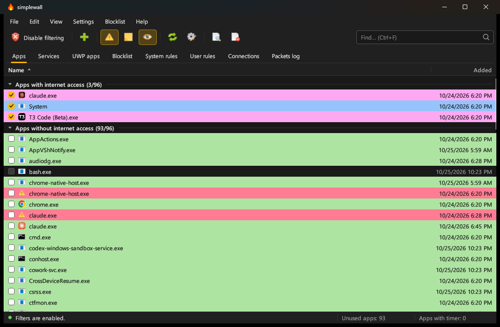

<h1 align="center">
  <br />
  Firebreak
</h1>

<p align="center">
  <a href="https://github.com/NitroDiesel/firebreak/releases/latest"></a>
  <a href="https://github.com/NitroDiesel/firebreak/releases"></a>
  <a href="LICENSE"></a>
</p>

<p align="center">
  A firewall for Windows that blocks every app until you allow it.<br />
  Based on <a href="https://github.com/henrypp/simplewall">simplewall</a> by Henry++, rewritten in Rust.
</p>

<p align="center">
  
</p>

## Contents

- [About](#about)
- [Download](#download)
- [Getting started](#getting-started)
- [Features](#features)
- [The window](#the-window)
- [Tray, notifications, and running in the background](#tray-notifications-and-running-in-the-background)
- [Filtering](#filtering)
- [Rules](#rules)
- [Connections and logs](#connections-and-logs)
- [Settings and profile](#settings-and-profile)
- [Command line](#command-line)
- [Uninstall](#uninstall)
- [FAQ](#faq)
- [Differences from simplewall](#differences-from-simplewall)
- [Building from source](#building-from-source)
- [Credits and license](#credits-and-license)

## About

Firebreak configures the [Windows Filtering Platform (WFP)](https://learn.microsoft.com/windows/win32/fwp/windows-filtering-platform-start-page), the part of Windows that inspects network traffic. It blocks all connections by default, and you choose which apps may connect.

Firebreak is not a front end for Windows Firewall and does not talk to it. WFP is a set of system services and APIs that firewalls are built on; Windows Firewall is one of them, and Firebreak is another. The two work side by side.

Firebreak is a Rust port of **[simplewall](https://github.com/henrypp/simplewall) 3.9.2 by Henry++**. It keeps simplewall's filtering engine, internal rules, blocklist, rule syntax, command line, profile formats, and its 29 translations, and puts them in a new interface. All credit for the original design goes to Henry++. See [Differences from simplewall](#differences-from-simplewall) for what changed.

## Download

Get the latest release from the [Releases page](https://github.com/NitroDiesel/firebreak/releases/latest).

| File | Use it for |
| --- | --- |
| `firebreak-<version>-setup.exe` | Installing on your own PC. Most people want this one. |
| `firebreak-<version>-setup.msi` | Deployment with Group Policy or Intune, or silent installs: `msiexec /i firebreak-<version>-setup.msi /qn`. |
| `firebreak-<version>-bin.zip` | The portable build. See [Portable mode](#portable-mode). |

Both installers put Firebreak in `C:\Program Files\Firebreak` with a Start menu entry named Firebreak, close a running copy first, and offer to start it when they finish. They install beside the original simplewall, never over it. Use one installer or the other, not both.

**System requirements**

- Windows 10 or Windows 11, 64-bit (x64).
- Administrator rights, to install or remove filters.
- A graphics driver with OpenGL 2.0 or later, which every Windows 10 PC has.

**"Unknown publisher" warning.** Firebreak names NitroDiesel as its publisher, but it is not code-signed yet, so Windows SmartScreen and UAC still say "Unknown publisher". Click **More info**, then **Run anyway**.

### Upgrading from simplewall (Rust)

Before version 4.0, Firebreak was called simplewall (Rust). Installing Firebreak removes simplewall (Rust) 3.9.x, and keeps everything:

- Your settings, apps, and rules move from `%ProgramData%\simplewall-rust` to `%ProgramData%\Firebreak`.
- "Load on system startup" and "Skip UAC warning" move to the new scheduled tasks.
- Installed filters stay on throughout.

The move happens the first time Firebreak runs as administrator. Leave **Start Firebreak** ticked on the installer's last page and it happens right away.

## Getting started

1. Install and start Firebreak. Windows asks for administrator rights, because only an administrator can change filters.
2. On the first run, Firebreak lists the apps, services, and Store apps on your PC. If you used the original simplewall, its apps and rules are imported from `%APPDATA%\Henry++\simplewall\profile.xml`.
3. Tick the apps that may use the network. Everything unticked is blocked.
4. Click **Enable filters** on the toolbar. Choose **Permanent** to keep filtering after a restart, or **Until reboot** to try it out.
5. When an app that is not allowed tries to connect, a notification asks whether to allow or block it.

Filters keep working when Firebreak is closed or not running at all. To stop filtering, click **Disable filters**.

## Features

- Blocks every app by default; allow apps one by one.
- Notifications when a blocked app tries to connect, with Allow, Allow for a set time, and Block.
- Apps, Windows services, and Microsoft Store (UWP) apps, each matched the way Windows identifies them.
- Your own rules, for all apps or only some, by address, range, CIDR block, or port.
- simplewall's internal blocklist for Microsoft telemetry, updates, and apps, from [WindowsSpyBlocker](https://crazymax.dev/WindowsSpyBlocker/).
- Timers that allow an app for a set time, then block it again.
- A live Connections tab with download and upload speeds per connection, and a Packets log of blocked connections.
- Stealth mode, so port scans get no reply.
- Boot-time filters, so the PC is protected before the firewall engine starts.
- Digital signature checks for every app, and optional file hash checks that block an app again if its file changes.
- A dark or light theme that follows Windows, and your Windows accent color.
- simplewall's 29 languages.
- Runs from the tray, starts at sign-in, and skips the UAC prompt if you want.
- Reads and writes simplewall profiles, plain, compressed, or encrypted.
- IPv4 and IPv6.
- Free and open source, GPL-3.0.

## The window

The layout follows simplewall: a menu bar (File, Edit, View, Settings, Blocklist, Help), a toolbar, and a search box on the right. Below them are the tabs **Apps**, **Services**, **UWP apps**, **Blocklist**, **System rules**, **User rules**, **Connections**, and **Packets log**. The status bar shows whether filters are on, how many apps are unused, and how many have a timer.

**Toolbar buttons**, from left to right:

- Enable or disable filters. It asks first, and also offers "Until reboot".
- Create rule.
- Notifications, log to file, and log to the Packets log.
- Refresh, and Settings.
- Show log, and clear log.

**Lists** are grouped as in simplewall:

- Apps: "Apps with internet access", "Apps with timer", "Apps with user rules", "Apps without internet access".
- Rules: "Enabled rules [for all]", "Enabled rules [for apps]", "Disabled rules".
- Click a column header to sort. Click a group header to collapse it.
- Search matches part of a name or path. Start the search with `re:` to use a regular expression.

**Row colors** match simplewall. Each one can be turned off in Settings > Appearance.

| Color | Meaning |
| --- | --- |
| Red | The file is missing, or the rule has a syntax error. |
| Pink | The app has an active connection. |
| Green | The app is digitally signed. |
| Yellow | The rule applies to specific apps. |
| Gray | A pinned app. |
| Blue | A system app or service. |

**Working with rows**

- Double-click a row, or press Enter, to open the rule editor or the app's properties.
- Right-click for timers, pin, open containing folder, copy, and delete.
- Deleting an app or a user rule asks first. There is no undo.

**Keyboard shortcuts**

| Keys | Action |
| --- | --- |
| Ctrl+F | Search |
| F5 | Refresh |
| F2 | Settings |
| F1 | About |
| Ctrl+Tab, Ctrl+Shift+Tab | Next or previous tab |
| Space | Tick or untick the row |
| Del | Delete |
| Ctrl+C | Copy |
| Ctrl+E | Open containing folder |
| Ctrl+I | Show log |
| Ctrl+X | Clear log (asks first) |
| Ctrl+Shift+X | Purge unused apps (asks first) |
| Ctrl+Shift+T | Purge timers |

Tab moves between controls and draws a focus ring. The arrow keys move through the list. Dialogs keep focus inside them and close with Escape.

**View menu**

- Always on top, dark theme, and show file names only.
- Autosize columns.
- Show search bar. Ctrl+F brings it back.
- Details, Icons, or Tiles, with small, large, or extra-large icons. "Do not load icons" skips reading app icons.
- Language, and Font.

The last tab, the sort order, and the window size are remembered. Animations follow Windows' "Animation effects" setting. Errors in the status bar stay until you click them, and hovering over cut-off text shows all of it.

## Tray, notifications, and running in the background

- **The X button sends Firebreak to the tray.** It keeps running in the background, so notifications and timers keep working. To quit, choose **Exit** from the tray menu or the File menu.
- Minimizing also sends the window to the tray.
- Click the tray icon to show or hide the window. Starting Firebreak a second time brings the running window back.
- The tray menu has simplewall's items: Show/Hide, Enable or disable filters, Notifications, Packets log, Settings, Website, About, and Exit.
- **The flame turns gray while filters are off**, in the tray, the title bar, and the taskbar.
- Exit asks first while filters are on, because installed filters keep working after Firebreak quits. Turn this off with Settings > General > "Show confirmation dialog on exit".
- Settings > General has **Load on system startup**, **Start minimized**, and **Skip UAC warning**. They use Task Scheduler with highest privileges, so there is no UAC prompt at sign-in or when you start Firebreak.

**Notifications.** When an app that is not allowed tries to connect, a notification appears in the middle of the screen. It shows the app, its signer, the remote address and host name, the port, the protocol, and the time. It offers Allow, Allow for a set time, Block, and a menu with Create rule, Open containing folder, Kill process, and Disable notifications for this app.

- Block stops further notifications for that app.
- The same app waits 60 seconds between notifications.
- The sound is skipped while a full-screen app is in front.
- Apps seen in blocked connections are added to the list automatically.

## Filtering

Ticked apps are allowed. A lowest-weight block filter drops every other connection. Firebreak always allows itself, so it can still remove its own filters.

Settings > Filters has simplewall's options. The ones simplewall recommends are marked "(recommended)", and are on by default.

| Option | Default |
| --- | --- |
| Allow loopback connections for all (recommended) | On |
| Allow IPv6 redirections (6to4) for all (recommended) | On |
| Allow local network (LAN) | Off |
| Allow Windows Update | Off |
| User rules take priority over the blocklist | On |
| Block outbound connections for all (recommended) | On |
| Block inbound connections for all (recommended) | On |
| Use stealth mode (recommended): port scans get no reply | On |
| Enable boot-time filters (recommended): filter from the moment Windows starts | On |
| Allow IP forwarding: keeps Mobile Hotspot and Internet Connection Sharing working | Off |
| Disable internal rules: install only your own rules | Off |

**Blocklist.** The Blocklist menu, and Settings > Blocklist, set each group to Disable, Allow, or Block:

| Group | Recommended |
| --- | --- |
| Microsoft spying and telemetry | Block |
| Microsoft update | Disable |
| Microsoft applications | Disable |

**Windows Update.** "Allow Windows Update" (in the Settings menu or Settings > Filters) is simplewall's Windows Update fix. The Windows Update services run from a copy of svchost.exe named `wusvc.exe`, and only that copy is allowed, so updates work while every other svchost.exe service stays blocked.

**How apps are matched**

- Programs: by file path.
- Services: by service SID.
- Microsoft Store apps: by package SID.
- Kernel traffic: as the `System` app.

Per-user service instances (such as `CDPUserSvc_1a2b3`) get a new name at every sign-in, so they are not listed. Allow `svchost.exe` to cover them.

**Permanent or until reboot.** Permanent filters stay until you disable them. "Until reboot" filters are removed when Windows restarts.

**Timers** allow an app until the time runs out, then block it again. Turning a timer off also blocks the app. Timers count down only while Firebreak runs, which it does in the tray. Exiting with timers running asks to end them first.

## Rules

There are two kinds of user rules:

- **For all apps**: the rule applies to every app.
- **For specific apps**: the rule applies only to the apps you pick in the rule editor's Apps tab.

User and custom allow rules take priority over the blocklist. To let a blocklist entry win, turn off "User rules take priority over the blocklist".

Firebreak also loads simplewall's internal system rules (DHCP, DNS, NCSI, and others) and blocklist from [`resources/profile_internal.xml`](resources/profile_internal.xml), the file simplewall ships.

### Rule syntax

Separate entries with a semicolon.

| Entry | Example |
| --- | --- |
| IP address | `192.168.0.1; [fc00::1]` |
| IP address with port | `192.168.0.1:80; [fc00::1]:443` |
| IP range | `192.168.0.1-192.168.0.255` |
| IP range with port | `192.168.0.1-192.168.0.255:443` |
| CIDR block | `192.168.0.0/16; fe80::/10` |
| Port | `21; 80; 443` |
| Port range | `20-21; 49152-65534` |

A rule with a syntax error shows in red, and the rule editor says what is wrong.

<details>
<summary>IPv4 CIDR blocks</summary>

| Block | Mask | Addresses |
| --- | --- | --- |
| a.b.c.d/32 | 255.255.255.255 | 1 |
| a.b.c.d/31 | 255.255.255.254 | 2 |
| a.b.c.d/30 | 255.255.255.252 | 4 |
| a.b.c.d/29 | 255.255.255.248 | 8 |
| a.b.c.d/28 | 255.255.255.240 | 16 |
| a.b.c.d/27 | 255.255.255.224 | 32 |
| a.b.c.d/26 | 255.255.255.192 | 64 |
| a.b.c.d/25 | 255.255.255.128 | 128 |
| a.b.c.0/24 | 255.255.255.0 | 256 |
| a.b.c.0/23 | 255.255.254.0 | 512 |
| a.b.c.0/22 | 255.255.252.0 | 1,024 |
| a.b.c.0/21 | 255.255.248.0 | 2,048 |
| a.b.c.0/20 | 255.255.240.0 | 4,096 |
| a.b.c.0/19 | 255.255.224.0 | 8,192 |
| a.b.c.0/18 | 255.255.192.0 | 16,384 |
| a.b.c.0/17 | 255.255.128.0 | 32,768 |
| a.b.0.0/16 | 255.255.0.0 | 65,536 |
| a.b.0.0/15 | 255.254.0.0 | 131,072 |
| a.b.0.0/14 | 255.252.0.0 | 262,144 |
| a.b.0.0/13 | 255.248.0.0 | 524,288 |
| a.b.0.0/12 | 255.240.0.0 | 1,048,576 |
| a.b.0.0/11 | 255.224.0.0 | 2,097,152 |
| a.b.0.0/10 | 255.192.0.0 | 4,194,304 |
| a.b.0.0/9 | 255.128.0.0 | 8,388,608 |
| a.0.0.0/8 | 255.0.0.0 | 16,777,216 |
| a.0.0.0/7 | 254.0.0.0 | 33,554,432 |
| a.0.0.0/6 | 252.0.0.0 | 67,108,864 |
| a.0.0.0/5 | 248.0.0.0 | 134,217,728 |
| a.0.0.0/4 | 240.0.0.0 | 268,435,456 |
| a.0.0.0/3 | 224.0.0.0 | 536,870,912 |
| a.0.0.0/2 | 192.0.0.0 | 1,073,741,824 |
| a.0.0.0/1 | 128.0.0.0 | 2,147,483,648 |
| 0.0.0.0/0 | 0.0.0.0 | all |

</details>

<details>
<summary>IPv6 CIDR blocks</summary>

An IPv6 block is written the same way, as an address and a prefix length from 0 to 128, such as `2001:db8::/32` or `fe80::/10`. A /64 is one typical home or office network; a /128 is a single address. See [IPv6 range blocks](https://www.mediawiki.org/wiki/Help:Range_blocks/IPv6) for a full table.

</details>

## Connections and logs

- The **Connections** tab refreshes every 2 seconds. It lists every TCP connection and UDP endpoint, with host names for remote addresses, and can keep showing the connections of programs that have exited.
- Running as administrator, it also shows each connection's download and upload speed and total traffic. TCP is always measured. UDP and QUIC are measured when Settings > Connections > "Measure UDP/QUIC traffic" is on.
- The **Packets log** tab updates live with the connections Firebreak blocked.
- **Log to file** writes simplewall's CSV columns to `%USERPROFILE%\firebreak.csv`. The file starts over at a size limit, 1 MB by default.
- Port scans dropped by stealth mode are left out of both logs unless you turn that off.

## Settings and profile

Your apps, rules, and settings are saved in `%ProgramData%\Firebreak\profile.xml`. Only administrators can change that folder. It stays the same when Administrator Protection runs the elevated app under a separate account.

- A day-old copy is kept as `profile.xml.bak`, and is used if the profile cannot be read.
- **File > Import** reads a Firebreak or simplewall profile, plain, compressed, or encrypted. **File > Export** saves the profile anywhere.
- **Settings > Profile type** saves the profile as plain XML, compressed, or encrypted, in simplewall's formats.

### Portable mode

Put an empty file named `firebreak.ini` next to `firebreak.exe`, and the profile is kept in that folder instead. Use this with the portable zip.

## Command line

```
firebreak.exe -install          Enable filters.
firebreak.exe -install -temp    Enable filters until the next reboot.
firebreak.exe -install -silent  Enable filters without asking.
firebreak.exe -uninstall        Remove all installed filters.
firebreak.exe -status           Report whether filters are installed.
firebreak.exe -help             Show this list.
```

With no arguments, the window opens. The command line needs an elevated console, and prints to the console it was started from. An interactive `cmd` prompt does not wait for GUI programs, so use `start /wait firebreak.exe -install` to read `%ERRORLEVEL%`. Batch files wait as usual.

## Uninstall

Uninstall Firebreak from **Settings > Apps > Installed apps**. The uninstaller removes the program, the Start menu entry, and the startup and skip-UAC tasks.

**Filters stay installed after uninstalling**, as with simplewall, and keep blocking. To remove them, open Firebreak and click **Disable filters** before you uninstall, or run `firebreak.exe -uninstall` from an elevated console. Your profile stays in `%ProgramData%\Firebreak` in case you reinstall.

## FAQ

**Are connections blocked while Firebreak is not running?**
Yes. Installed filters work whether Firebreak is running, closed, or uninstalled.

**Which apps are blocked by default?**
All of them. You don't need rules to block an app; untick it.

**Can I use Firebreak with Windows Firewall?**
Yes. You don't need to turn Windows Firewall off. The two work independently.

**How do I turn the blocklist off completely?**
In the Blocklist menu, set each group to Disable. Or open Settings > Blocklist and choose Disable for each group.

**How do I block only some apps and allow the rest?**
This is the "blacklist" mode simplewall dropped. You can still set it up:

1. Open Settings > Filters.
2. Turn off "Block outbound connections for all" and "Block inbound connections for all".
3. Create a rule (the plus button on the toolbar) with the Block action, direction Both, a name such as "Block connection", and empty addresses.
4. Assign the rule to each app you want to block.

**Why does the network icon show "No internet"?**
Windows tests the connection through the Network Connectivity Status Indicator (NCSI). Fix it one of three ways:

<details>
<summary>Allow the NCSI system rule</summary>

Open the **System rules** tab and tick **NCSI**. It is on by default.

</details>

<details>
<summary>Turn NCSI off in the registry</summary>

Save this as `Disable NCSI.reg` and open it:

```reg
Windows Registry Editor Version 5.00

[HKEY_LOCAL_MACHINE\SOFTWARE\Policies\Microsoft\Windows\NetworkConnectivityStatusIndicator]
"NoActiveProbe"=dword:00000001
"DisablePassivePolling"=dword:00000001
```

</details>

<details>
<summary>Turn NCSI off with Group Policy</summary>

1. Run `gpedit.msc`.
2. Go to Computer Configuration > Administrative Templates > System > Internet Communication Management > Internet Communication settings.
3. Open "Turn off Windows Network Connectivity Status Indicator active tests", choose Enabled, and click OK.
4. Run `gpupdate /force` in an elevated Command Prompt.

</details>

**How do I fix Windows Update?**
Turn on **Allow Windows Update** in the Settings menu or Settings > Filters. See [Filtering](#filtering) for how it works.

**How do I turn Windows Firewall off or on?**
In an elevated Command Prompt:

```bat
netsh advfirewall set allprofiles state off
netsh advfirewall set allprofiles state on
```

**How do I see every installed filter?**
In an elevated Command Prompt, these write `filters.xml` and `wfpstate.xml` to the current folder:

```bat
cd /d %USERPROFILE%\Desktop
netsh wfp show filters
netsh wfp show state
```

Firebreak's filters belong to the provider `B0D553E2-C6A0-4A9A-AEB8-C752483ED62F` in the sublayer `9FEE6F59-B951-4F9A-B52F-133DCF7A4279`. These are simplewall's identifiers, so **Disable filters** in either program removes the other's filters too.

**Why does Windows ask for administrator rights?**
Only an administrator can install or remove filters. Turn on Settings > General > "Skip UAC warning" to start Firebreak elevated through a scheduled task, with no prompt. If you decline the prompt, the window still opens, but filters cannot be changed.

**Can Firebreak show up in Windows Security as my firewall?**
No. Windows only allows that for [registered security vendors](https://stackoverflow.com/questions/3698285/how-can-i-tell-the-windows-security-center-that-im-an-antivirus/3698375#3698375).

**Can I run Firebreak and simplewall at the same time?**
Not at the same time: they share the same filter identifiers and would overwrite each other's filters. Installing both is fine.

## Differences from simplewall

New in Firebreak:

- A new interface, with dark and light themes, the Windows accent color, and keyboard focus that is visible.
- Closing the window keeps Firebreak running in the tray.
- Download and upload speeds on the Connections tab.
- Filters are installed on a background thread, so the window doesn't freeze while 1,500 blocklist rules are applied.
- Settings are kept in `%ProgramData%`, so they survive Administrator Protection.
- Allow local network (LAN), as a single option.
- An MSI package for managed deployment.

Not carried over:

- Windows 7, 8, and 8.1, and 32-bit and ARM64 builds.
- The donate button.
- GPG signatures on the binaries.

## Building from source

Releases are built on GitHub by the [`release` workflow](.github/workflows/release.yml), not on a workstation. Every push runs the tests in the [`ci` workflow](.github/workflows/ci.yml).

- **Publish a release:** push a `v*` tag. The workflow builds the setup, the MSI, and the portable zip, and publishes them.
- **Try installer changes:** run the `release` workflow by hand from the Actions tab. It builds the same three files as a workflow artifact, without publishing.

To build locally, install [Rust](https://rustup.rs/) and run:

```
cargo build --release
```

The program is `target\release\firebreak.exe`. `installer\build.ps1` builds the installers, and needs [NSIS](https://nsis.sourceforge.io/) and the [WiX](https://wixtoolset.org/) 5 dotnet tool.

Firebreak checks for a newer release once a day. Help > Check for updates checks right away.

<details>
<summary>Where simplewall's code went</summary>

| simplewall (C) | Firebreak (Rust) |
| --- | --- |
| `wfp.c`: provider, sublayer, global filters, app permits, rules, transactions | `src/wfp.rs` |
| `log.c`: drop events, the Packets log, the log file | `src/netevents.rs`, `src/ui/mod.rs` |
| `notifications.c`: the notification window | `src/ui/notify.rs` |
| `db.c`, `profile.c`: internal rules, blocklist, the user profile, compressed and encrypted profiles | `src/profile.rs`, `src/swc.rs` |
| `helper.c`: signatures and file hashes | `src/security.rs` |
| `network.c`: the connection monitor | `src/log.rs`, `src/ui/monitor.rs` |
| Rule syntax | `src/rules.rs` |
| Apps, services, and Store apps | `src/apps.rs` |
| Tray icon | `src/tray.rs` |
| Load on startup and skip UAC | `src/autorun.rs` |
| Update check | `src/update.rs` |
| Language file | `src/i18n.rs` |
| `main.c`: command line | `src/cli.rs` |
| Win32 dialogs and list views | `src/ui/` |

</details>

## Credits and license

- **[simplewall](https://github.com/henrypp/simplewall)** is by **Henry++** ([github.com/henrypp](https://github.com/henrypp)), © 2016–2026. Firebreak's filtering design, internal rules, rule syntax, profile formats, and translations all come from it. If Firebreak is useful to you, consider supporting the original.
- The blocklist comes from [WindowsSpyBlocker](https://github.com/crazy-max/WindowsSpyBlocker) by CrazyMax.
- simplewall's translations are by its community of translators.
- The Rust port and Firebreak are by [NitroDiesel](https://github.com/NitroDiesel).

Firebreak is free software under the [GNU General Public License v3.0](LICENSE), the same license as simplewall.
